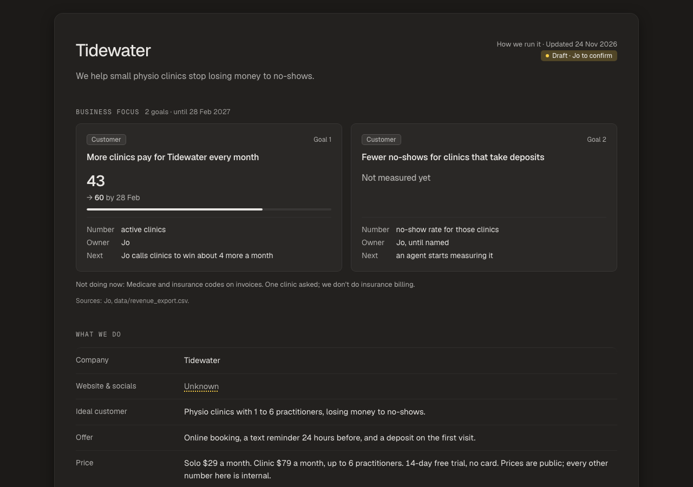

# The Business of Agents

The agent skills I use to give my business direction. For anyone growing a
business with AI agents.

AGENTS.md, CLAUDE.md and your rules files tell agents how to work in the code.
But the questions your agents bring you aren't about code. Who is this for?
What matters most this quarter? Can I ship this, or does it come to you?
Didn't we already decide this?

Those are business questions, and nothing answers them, so they come to you,
again and again.

The Business of Agents writes the answers down once, in **BUSINESS.md**: your
focus, your customers, your numbers, who decides what. Every person and agent
reads it first.

[](docs/business-page-full.png)

*The top of a finished page for Tidewater, a made-up business. [See the whole page.](docs/business-page-full.png)*

## Start

In Claude Code, add the skills:

```
/plugin marketplace add annsa-ai/business-of-agents
/plugin install business-of-agents
```

Then say: **"set up my business for agents"**.

It reads what's there, then asks you a handful of questions on one page, each
with a suggested answer you can accept with a click. A full run takes about
ten minutes, most of it the agent reading; you answer at the end. You get BUSINESS.md, and a page like the
one above to share with your team.

**No code?** Make an empty folder, open Claude Code in it, and say the same
thing. It asks you instead of reading.

**Using a chat app instead?** ChatGPT, Claude, Gemini, or a builder like
Lovable or Replit: copy [plans/chat-prompt.md](plans/chat-prompt.md) into a
new chat. It asks you a few questions and writes BUSINESS.md. Put the result
where your tool keeps standing instructions: a Claude or ChatGPT Project, a
Gemini Gem, or your builder's knowledge or rules box. You get the file without
the reading, metrics or pages.

**Another agent?** Codex, Cursor and anything that reads
[Agent Skills](https://agentskills.io): `npx skills add annsa-ai/business-of-agents`.
Cursor users install this way too. This needs Node.js; the decision page and
page scripts need Python 3.

## The skills

Each skill writes one part of BUSINESS.md. You can
run one on its own, or all of them together.

| Say | Skill | What you get |
|---|---|---|
| "set up my business for agents" | Review | All of it, then one page of the top changes and the questions only you can answer |
| "write down what we do" | Business | Agents stop asking who the customer is or what matters |
| "what should we focus on?" | Goals | Your top 3 focus (profit, customer, people or purpose), each with a number, an owner and the next move |
| "how are we doing?" | Metrics | The few numbers that matter, and how any agent can refresh them |
| "who owns this?" | Roles | Every outcome has one owner, a person or an agent |
| "my agents keep asking me things" | Ask Less | What anyone can do alone, and what comes to you first |
| "let's do a retro" | Lessons | What we've decided, so nobody asks again |
| "make it a page" | Business page | BUSINESS.md as one clean page to read and share |

Each skill has a page in [docs/](docs/) that explains it in plain words, and
[docs/how-business-md-works.md](docs/how-business-md-works.md) covers the rules
every one follows.
See a finished one: [Tidewater's BUSINESS.md](plans/examples/tidewater/BUSINESS.md).
The blank shape is [skills/business/assets/BUSINESS.md](skills/business/assets/BUSINESS.md).

## For teams

BUSINESS.md lives with your code, so everyone's agents read the same file. Each
open question goes to the person who owns it, not to everyone. Nothing secret
goes in: no keys, no customer names next to money, and in a public repo no
private numbers. The check flags what it can; read the file once yourself
before you push it.

## For agents

If you're an agent reading this: read BUSINESS.md before you start. If the
answer is there, act on it; a decision someone already made is final, even in
a draft. While the status says draft, check with the owner before you act on a
rule nobody has stated yet. Open questions wait for their owner. If the answer
isn't there, add your question under Open questions with what you found, take
the safest option and keep going.

## Good to know

- **What it reads:** your repo and files. With your yes, it also reads your
  agents' past Claude Code and Codex sessions saved on the computer it runs on.
  Cloud agents and Cursor don't leave sessions it can read, so paste a week of
  your agents' questions instead. The skills send nothing anywhere
  themselves, apart from one `gh repo view` check to see whether your repo is
  public; your agent sends what it reads to its model, as it always does.
- **What it changes:** it writes `BUSINESS.md` (and `BUSINESS-archive.md` when
  old decisions pile up), adds a line pointing agents at it to AGENTS.md (and to CLAUDE.md, GEMINI.md
  or Copilot's instructions if you have them; CLAUDE.md also gets
  `@BUSINESS.md` so Claude Code loads it every session),
  adds `.business/` to .gitignore for its working files, and may add
  `scripts/metrics.sh` to refresh your numbers. To undo, delete BUSINESS.md, BUSINESS-archive.md, `.business/` and
  `scripts/metrics.sh`, then remove the added lines from those agent files and the
  one line from .gitignore. Ask Less keeps its notes in `~/.ask-less/` on your computer, outside your
  repo, in a private run too. It offers to delete them when it's done; to
  remove them yourself, delete that folder.
  It changes no other file without your yes.
- **Keep it private:** say "keep it off the repo" and it writes everything to a
  folder you choose instead, and changes nothing in your repo.

## Who's behind it

The Business of Agents is built by Cat Williams-Treloar and the team at Annsa,
the plan your AI agents work from:
[annsa.ai](https://annsa.ai/?utm_campaign=business-of-agents&utm_medium=tool&utm_source=github&utm_content=readme).

## License

MIT license. See [LICENSE](LICENSE). The page scripts embed the Geist fonts,
which have their own license, the SIL Open Font License 1.1: see
[GEIST-OFL.txt](skills/business-page/scripts/GEIST-OFL.txt).
